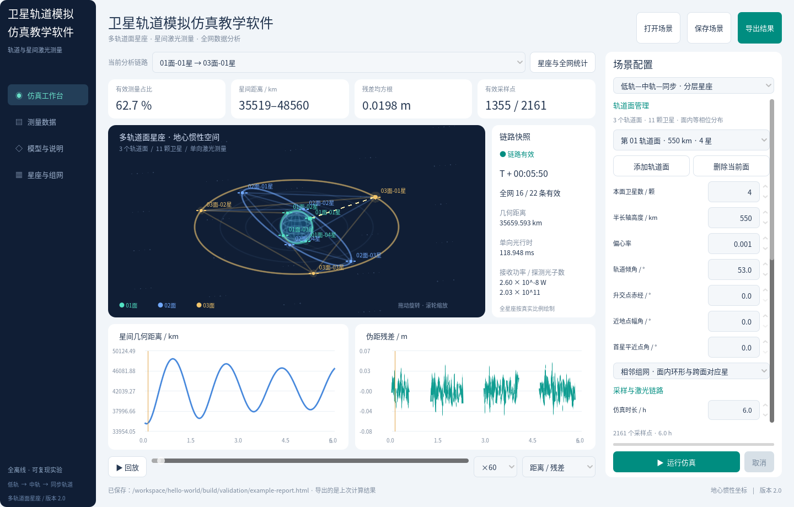
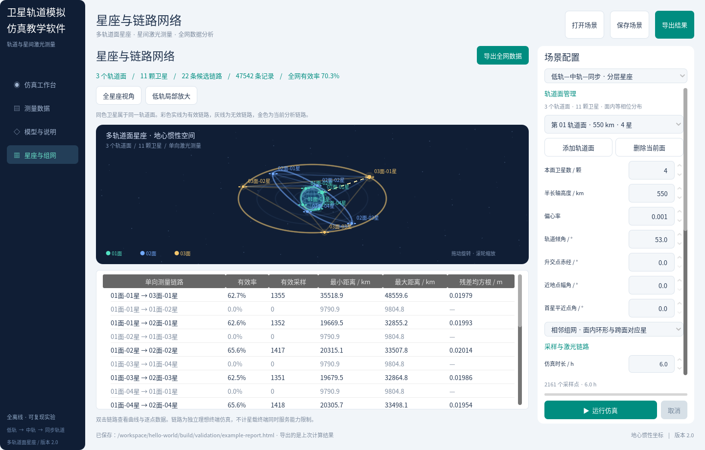

# 卫星轨道模拟仿真教学软件

全中文、离线 Windows 桌面软件，支持从低轨到地球同步高度的多轨道面、多卫星星间激光测量数据仿真。

## 直接运行

[下载 Windows 64 位程序包](releases/卫星轨道模拟仿真教学软件-2.0-Windows-x64.zip) · [下载完整源码](releases/卫星轨道模拟仿真教学软件-2.0-源码.zip)

解压后双击 `卫星轨道模拟仿真教学软件.exe`。Windows 10/11 x64，显卡驱动支持 OpenGL 3.3，无需安装 Python、Godot 或其他运行工具。

## 功能

- 2—8 个独立轨道面、每面 2—12 星，总计最多 72 星。
- 各轨道面独立设置六个轨道参数，支持低轨、中轨、同步高度混合星座。
- 相邻组网、全互联星对计算；全网统计和逐链路分析。
- 多星轨道视图、链路高亮、旋转缩放、低轨局部放大、时间回放。
- 单向光行时、地球遮挡、激光链路与光子预算、伪距噪声及偏差。
- 后台计算、取消、参数与容量校验、分页数据、曲线与有效窗口。
- 星座场景保存载入、全网 CSV、独立中文 HTML 报告。

默认 3 面 11 星、22 条链路、47,542 条测量记录。完整操作见 [使用说明](docs/USER_GUIDE.md)，测试范围见 [验证记录](docs/VALIDATION.md)。





## 开发与构建

使用 Godot 4.6.3 Standard 打开 `orbitlaser/project.godot`。Windows 重新构建见 [构建说明](docs/BUILD_WINDOWS.md)。

```bash
python scripts/build.py --godot godot --target windows --package
```

需要 Python 3.10+、固定版本的构建依赖，以及同版本官方 Windows 导出模板。构建脚本先暂存工程，再执行测试、导出、图标写入和内嵌资源包启动检查。

采用教学与工程近似模型，不代替高精度任务定轨或工程认证。Linux 下的资源包检查不等于 Windows 原生运行测试。
